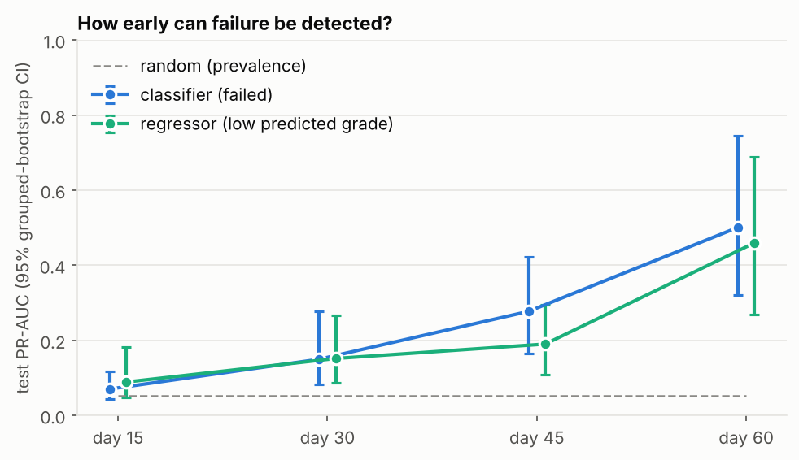

# Student Early-Warning System

**How early can we tell that a student is going to fail a course, and with what confidence?**

An end-to-end project built on a university LMS activity log (≈196k rows, 600 students, 582 courses). It covers data-quality auditing, statistical inference, point-in-time feature engineering, comparison of predictive models across four prediction horizons, and a tested, containerized FastAPI service.

> Originally an EdMachina technical challenge (*Data Scientist / ML Engineer* track), rebuilt as a portfolio project. The dataset is not redistributed; see [`data/README.md`](data/README.md).



## Key results

* **The data needed real cleaning.** The raw file is a wide log where exam, assignment and submission columns share rows *without being related*. I found and resolved 18 inconsistencies, including a bulk-migration timestamp, an ambiguous period label, grade = 0 meaning "absent" and duplicated events, and documented each decision ([`docs/data_quality_decisions.md`](docs/data_quality_decisions.md)).
* **The question was reframed to avoid leakage.** The final grade is ~90% determined by the partial exams (Spearman ρ = 0.91). A model fed the whole course looks great, but it is close to re-implementing the grading rule. So the models are trained for **four horizons (days 15, 30, 45, 60)** using only information available on each day, and a test checks that future events cannot change any feature.
* **When signal appears.** Before the first partial (day 15) behaviour alone is barely above chance (test PR-AUC 0.07 vs a 0.05 baseline). By **day 45** a calibrated logistic regression reaches **ROC-AUC 0.87** and, at 77% recall, flags 23% of students, among whom failures are **3× more frequent** than baseline. By day 60, PR-AUC is 0.50 and grade MAE 0.32.
* **Simple wins when the data is small.** With only 156 failures, the one-standard-error rule picked **logistic regression** at days 30 and 45 over tuned LightGBM. Gradient boosting only pays off at day 60, when exam interactions dominate.
* **Statistics beyond prediction.** Effect sizes with bootstrap CIs and Holm correction, odds ratios, mixed-model ICCs (student 0.47 vs course 0.13, which justifies grouping by student) and cluster-robust regressions showing that behaviour adds a small but significant signal beyond exam grades.

| Horizon | Classifier | Test PR-AUC [95% CI] | ROC-AUC | Recall / Precision at threshold | Grade MAE |
|---|---|---|---|---|---|
| Day 15 | LightGBM | 0.07 [0.04–0.12] | 0.63 | 0.87 / 0.07 | 1.30 |
| Day 30 | Logistic regression | 0.15 [0.08–0.28] | 0.73 | 0.77 / 0.09 | 1.06 |
| **Day 45** | **Logistic regression** | **0.28 [0.16–0.42]** | **0.87** | **0.77 / 0.17** | **0.74** |
| Day 60 | LightGBM | 0.50 [0.32–0.75] | 0.94 | 0.74 / 0.32 | 0.32 |

*Held-out 20% of students (593 enrollments, 31 failures); CIs from a grouped bootstrap. Failure prevalence ≈ 5.2%.*

## What's inside

| Role in the challenge | Deliverable | Where |
|---|---|---|
| EDA | data structure, data quality, target, timing of exams, engagement curves | [`notebooks/01_eda.ipynb`](notebooks/01_eda.ipynb) |
| Advanced statistics | effect sizes, multiple testing, odds ratios, ICC, cluster-robust GLM/OLS | [`notebooks/02_statistical_inference.ipynb`](notebooks/02_statistical_inference.ipynb) |
| Feature engineering | 37 point-in-time features (context, engagement, performance, timing, exams) | [`src/early_warning/features/build.py`](src/early_warning/features/build.py) |
| Model comparison | dummy, linear, tree, random forest, HistGB, tuned LightGBM; repeated grouped CV; 1-SE rule; calibration | [`src/early_warning/models/train.py`](src/early_warning/models/train.py), [`notebooks/03_modeling_results.ipynb`](notebooks/03_modeling_results.ipynb) |
| Final model | per-horizon models + justification, model card | [`docs/model_card.md`](docs/model_card.md) |
| Production | CLI pipeline, FastAPI service, Docker, CI, tests | [`src/early_warning/`](src/early_warning), [`Dockerfile`](Dockerfile), [`.github/workflows/ci.yml`](.github/workflows/ci.yml) |
| Scalability & efficiency | measured timings, scaling paths, robustness | [`docs/scalability.md`](docs/scalability.md) |
| BI | star-schema export + Power BI data model and DAX | [`docs/powerbi_data_model.md`](docs/powerbi_data_model.md) |

## Project structure

```
├── configs/config.yaml          # paths, horizons, thresholds, training settings
├── data/                        # raw / interim / processed / bi (git-ignored)
├── docs/                        # data-quality decisions, model card, scalability, Power BI
├── models/                      # trained models (joblib) + metadata (json)
├── notebooks/                   # 01 EDA · 02 statistical inference · 03 modeling results
├── reports/
│   ├── figures/                 # figures used in notebooks and README
│   └── metrics/                 # CV folds, model comparison, test results, importances
├── src/early_warning/
│   ├── data/                    # schema contract, loading, cleaning (+ report)
│   ├── features/                # point-in-time feature engineering
│   ├── models/                  # candidates, training/selection, evaluation, registry, inference
│   ├── api/                     # FastAPI app + Pydantic schemas
│   ├── bi/                      # star-schema export
│   └── cli.py                   # `early-warning` command
└── tests/                       # 43 tests on synthetic fixtures
```

## Quickstart

```bash
# 1. Install (Python ≥ 3.11)
python -m venv .venv && source .venv/bin/activate
make install-dev                      # pip install -c requirements.lock -e ".[analysis,dev]"

# 2. Run the whole pipeline (needs data/raw/challenge_edMachina.csv)
make pipeline                         # clean → features → train → score → export-bi
# or step by step:
early-warning clean                   # + reports/metrics/data_quality_report.md
early-warning features
early-warning train                   # ~6–7 min on 2 vCPUs
early-warning score --day 45          # batch risk scores for every enrollment

# 3. Quality checks
make test                             # pytest + coverage (no dataset needed)
make lint                             # ruff

# 4. Serve the API (uses the committed models; no data needed)
make serve                            # or: make docker-build && make docker-run
```

### API example

```bash
curl -X POST localhost:8000/predict -H "Content-Type: application/json" -d '{
  "user_uuid": "student-123", "course_uuid": "course-abc", "day": 45,
  "n_courses_in_period": 6, "course_size": 30,
  "exams": [{"exam_code": "P1", "particion": 27, "grade": 4}],
  "submissions": [
    {"particion": 10, "score": 70, "submission_type": "online_quiz", "hours_before_due": 30},
    {"particion": 25, "score": 55, "submission_type": "online_upload", "hours_before_due": 2}
  ],
  "assignments": [{"particion": 5, "assignment_id": 1}, {"particion": 20, "assignment_id": 2}]
}'
```

```json
{"user_uuid": "student-123", "course_uuid": "course-abc", "day": 45, "model_day": 45,
 "fail_probability": 0.13, "at_risk": true, "alert_threshold": 0.064, "predicted_grade": 5.84,
 "models": {"classifier": "logistic_regression", "regressor": "random_forest"}}
```

Other endpoints: `GET /health`, `GET /models` (versions, thresholds, test metrics), `POST /predict/batch` (up to 5,000 enrollments), and interactive docs at `/docs`.

## Methodological decisions (short version)

| Decision | Reason |
|---|---|
| Unit = enrollment (student × course); aggregate per `user_uuid / course_uuid / particion` | the outcome is per enrollment, as the challenge recommends |
| Split the wide log into 5 normalized tables | the exam, assignment and submission columns on a row are unrelated |
| Exclude final grade = 0 (5 cases) | it most likely means "absent", not a measured grade |
| Four prediction horizons with point-in-time features | the final grade is near-deterministic from exams; the value is in *early* detection |
| Grouped splits by student | ~5 enrollments per student, ICC 0.47 |
| PR-AUC as the primary metric, plus calibration and an explicit recall target | 5% positives; missing an at-risk student costs more than a false alarm |
| One-standard-error rule | with 156 positives, prefer the simplest model when differences are noise |
| Grouped bootstrap CIs on test | 31 test failures: point estimates alone would mislead |

## Limitations

A single semester of data (no out-of-time validation), few failures (wide CIs), and observational associations rather than causal effects. See [`docs/model_card.md`](docs/model_card.md) for intended use and risks.

## Tech stack

Python · pandas · scikit-learn · LightGBM · statsmodels · SciPy · FastAPI · Pydantic · pytest · ruff · Docker · GitHub Actions · Power BI (data model)

## License

MIT, for the code. The dataset belongs to its owner and is not included.
