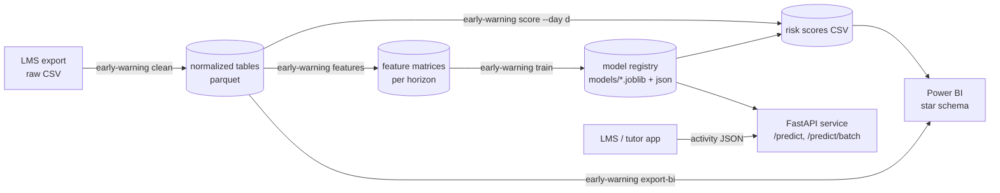

# Scalability, efficiency and production design

## 1. Architecture

**Design principles**

* **One feature function for every consumer.** `build_features(tables, cutoff)` is used by training, batch scoring and the API, which removes training/serving skew by construction. It is pure, vectorized `groupby` code: cost is O(number of events).
* **Point-in-time correctness is enforced by the code and by tests.** The API picks the latest model whose horizon is ≤ the request day, so a prediction never relies on information that cannot exist yet.
* **Stateless service.** Models are loaded once at start-up; each request carries its own activity. This allows horizontal scaling behind any load balancer.
* **Configuration over code.** Paths, cutoffs, thresholds and training settings live in `configs/config.yaml` (overridable with `EW_CONFIG`).
* **Reproducibility.** Fixed seeds, pinned versions (`requirements.lock`), and metadata stored with every artifact (training timestamp, versions, metrics, threshold, features).

## 2. Measured performance (2-vCPU sandbox)

| Step | Input | Time |
|---|---|---|
| `clean` | 196k raw rows → 5 tables | ~2.4 s |
| `features` (4 horizons) | 2,964 enrollments, ~30k events | ~1.3 s |
| `train` (8 models: 6 candidates × 15 CV folds + LightGBM search of 25 configurations × 5 folds, calibration, bootstrap, permutation importance) | 2,371 train rows | ~6.5 min |
| `score` (batch, one horizon) | 2,964 enrollments | < 2 s |
| API `/predict` | 1 enrollment | ~80 ms p50 in-process (≈45 ms features, ≈10–20 ms model) |
| API `/predict/batch` | 1,000 enrollments | ~0.13 s (≈0.13 ms per enrollment) |

Model files total ~5.5 MB; the largest are the random forests.

**Efficiency choices**

* Columns are read with explicit dtypes (`Int16` for the partition, categorical-like strings) and the cleaned tables are stored in **Parquet** (≈1.9 MB vs 34 MB of CSV).
* De-duplication happens *before* any join, on natural keys.
* Serving models are switched to `n_jobs=1`: for small payloads thread-pool overhead dominates, so parallelism comes from **workers**, not threads (`WEB_CONCURRENCY`, `OMP_NUM_THREADS=1`).
* The batch endpoint groups requests by horizon and scores each group with a single vectorized call.

## 3. Scaling paths

| Dimension | Current | When it grows |
|---|---|---|
| **Data volume** (more students/semesters) | pandas in memory, fine up to tens of millions of events | The feature logic is a set of filtered `groupby` aggregations and maps 1:1 to SQL / DuckDB / Polars / Spark (`WHERE particion < :cutoff GROUP BY user_uuid, course_uuid`). Run it in the warehouse and keep the same feature contract. |
| **Training** | sequential over 8 (horizon, task) jobs | The jobs are independent, so they can be parallelized (one job per horizon/task on a scheduler such as Airflow, Prefect or a Kubernetes Job). The randomized search is already parallel. |
| **Online traffic** | uvicorn with N workers | Stateless container: scale replicas horizontally (Kubernetes HPA / ECS) on CPU or latency. Memory per worker ≈ model size + Python. |
| **Batch scoring** | CLI over parquet | Nightly scheduled job writing to a table that Power BI reads; partition by `periodo`. |
| **Single-request latency** | ~80 ms | Pre-compute features incrementally as events arrive (a feature store keyed by enrollment), so the API only does the model call (~10 ms). For the linear models, the prediction could be served directly from their coefficients. |
| **Model management** | file registry (`registry.py`) | Replace `save_model` / `load_model` with MLflow (tracking + registry); the API already reads models by `(task, horizon)`. |

## 4. Robustness

* **Input contracts:** the raw loader fails fast on missing columns (`SchemaError`); the API validates every field with Pydantic (ranges for day, partition, grades and scores; exam codes from an allowed list) and returns 422 on bad input or on a day earlier than the first horizon.
* **Missing data by design:** features that do not exist yet (e.g. second partial on day 30) are `NaN`, not zero; models handle them natively or through imputers with missing indicators.
* **Health and observability:** `/health` (used by Docker `HEALTHCHECK`), `/models` (versions, thresholds, metrics), and an `X-Process-Time-ms` header on every response.
* **Security:** the container runs as a non-root user, the image is multi-stage (no build tools at runtime), and no data is baked into the image.
* **Tests and CI:** 43 tests on synthetic fixtures (no dataset needed) covering cleaning rules, point-in-time correctness, model selection logic and the API contract. GitHub Actions runs lint, tests on Python 3.12/3.13, a Docker build and a smoke test.

## 5. What a real production rollout would add

1. **Out-of-time validation** on the next semester before any use.
2. **Monitoring:** feature drift (PSI per feature and cohort), the alert rate, calibration once labels arrive, and the latency SLO.
3. **Retraining policy:** once per semester, or when drift or calibration alarms fire, gated by an automated comparison against the current model.
4. **Intervention logging** with a randomized holdout to measure impact and avoid feedback-loop bias.
5. **Authentication** (API key / OAuth) and rate limiting at the gateway.
